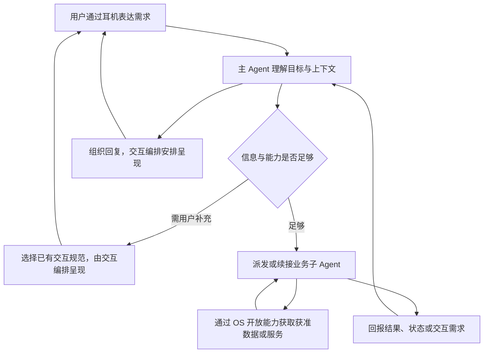

# 耳机子 Agent 产品交互规范 V0.1

适用：以耳机为语音入口，具备拍照、GPS 等硬件功能，由主 Agent 协同大量子 Agent 提供服务的产品。用于编写、生成和评审每个子 Agent 的产品 PRD。状态：产品设计基线；依赖实际能力的行为需联调验收。

## 设计基础

以 [conversational-ux](https://github.com/Owl-Listener/designer-skills/blob/main/interaction-design/skills/conversational-ux/SKILL.md) 为基础。先读[基础适配与详细规则](conversational-ux-base.md)：明确继承哪些原则、如何适配耳机，以及每份PRD必须作出的具体决定。本文继续规定产品职责与完整业务边界；两者共同使用。

## 规范目标：面向未知业务的通用语音交互
本规范面向需求方向和使用场景多样的耳机产品，帮助主Agent协同业务子Agent，形成一致、自然、可理解的语音体验。未来新业务不需要先归入一份已知功能清单，才能使用本规范。

规范按交互机制组织，而非按业务目录组织。提醒、打车、导航、陪伴等只是检验规则的例子。用户提供的40条方向作为多样性测试材料，检验规则能否解释不同场景；逐条映射只是案例记录，不代表规范的范围或完成标准。

### 四层结构
| 层级 | 解决什么问题 | 由谁维护 |
|---|---|---|
| 通用交互原则 | 用户如何发起、理解、控制和结束一次服务 | 产品交互规范 |
| 交互机制 | 追问、选择、确认、等待、反馈、打断、恢复和并发如何工作 | 共用模式与平台规范 |
| 场景参数 | 用户是否忙碌、时效、信息敏感度、可用输入输出、持续性等 | 具体PRD结合现有平台能力填写 |
| 业务规则 | 价格、路线、玩法、专业判断及实际执行条件 | 对应业务子Agent PRD |

通用规范给出默认规则、适用条件和允许变化的边界；具体PRD只补业务差异及必要例外。平台职责和权限边界按既有架构落实。一个机制跨多个业务复用，同一业务可以组合多个机制。

### 从任意需求生成交互设计
先明确用户目标、使用情境与成功标准，再沿下表识别交互特征。仅填写影响体验的项目，不把它变成用户必须逐项回答的问卷。

| 交互维度 | 需判断的问题 |
|---|---|
| 发起与结束 | 用户主动、事件触发还是持续服务？完成、退出和停止分别是什么？ |
| 输入与上下文 | 一句话足够还是多轮补充？语音、图像、位置和历史信息哪些必要、有效且获准？ |
| 目标与指代 | 当前在处理哪个人、物、任务或候选？更正后哪些信息失效？ |
| 轮次与控制 | 谁正在说话？何时让话？附和、纠正、停播、暂停与取消怎样区分？ |
| 执行与后果 | 只提供信息还是改变外部状态？何时需要确认？失败和结果未知怎样核对？ |
| 时间与持续性 | 立即、多阶段、后台还是持续监测？结果何时过期，失效如何告知？ |
| 反馈与表达 | 用户最先需要知道什么？怎样分段、选择、展开、重复及控制表达风格？ |
| 参与者与资源 | 是否涉及多人、其他设备或服务？谁可见、谁可操作，多个任务怎样竞争音频？ |
| 数据与记忆 | 数据用于本次还是长期保留？来源、授权、更新、纠错和删除怎样处理？ |
| 环境与恢复 | 行走、噪声、通话、摘下、断网等条件下，任务和交流怎样继续或结束？ |

输出“完整体验流程＋自然对话＋状态与异常＋验收预期”。[基础语音规范](standard.md)、[模式库](patterns.md)与本文通用规则共同构成基础；只有存在相应机制时才读取[扩展机制](future-interactions.md)。既有业务样板用于参考，不限制新需求。

### 泛化能力的验收
规范是否有效，要看一个未参与制定的新需求能否据此产生完整、一致且可验证的交互设计。需检查正常完成、歧义与纠正、失败与未知、打断退出，以及适用的异步和多任务；再由不同设计者比较关键决策是否一致。

若新需求只需填写参数和业务规则，复用成立；若反复需要补一条业务专用规则，先判断是否遗漏了通用机制。出现真正的新交互机制再扩规范。测试案例数量只表示测试材料规模，不能替代上述验证。当前尚未完成独立的新需求泛化验证。

## 产品事实与架构依据
用户已确认：耳机是语音入口，硬件有拍照、GPS 等功能，系统有主 Agent 和子 Agent，后续需编写大量子 Agent PRD。拍照/GPS 硬件存在已确认；开放接口、响应时间、数据精度、权限和可用性尚未验证。

本版按用户提供的项目基线回读版本1837对齐。PA指整个OS，MA为其中主Agent，FA为PA外独立业务服务。本规范将用户所说“子Agent”按业务FA处理；未来出现主Agent内部协作Agent时需另行映射，不能直接套用FA的边界。

当前架构是职责依据，不是已上线能力清单。本文制定产品交互要求，不扩建整体OS或重新设计路由算法。

## 整体体验：统一入口，业务有界，结果连续

图中“获取数据”表示能力依赖关系，不指定每类传感器的内部调用路径。交互类拍照与主动采集在架构中有不同路径，功能PRD需标明用途，实际接入由对应平台接口落地。

### 分工
| 角色 | 在子 Agent 交互中的职责 |
|---|---|
| 主 Agent | 理解用户意图、选择或续接FA、利用已有上下文、组织追问和回复、决定业务级后续动作 |
| 子 Agent | 业务规则、专业判断与执行；回报真实状态、结果、所缺信息、权限需求和建议话术 |
| 交互编排 | 维护交互规范；按设备形态、占用和勿扰等状态决定呈现通道与时机，回报投递和交互结果 |
| OS能力与设备服务 | 按授权提供拍照、定位等能力，处理资源仲裁及执行回执 |

子 Agent 不直接抢占耳机麦克风、相机或扬声器，不直接与其他FA互调。业务需要其他服务时描述依赖，由现有OS机制承接。用户侧保持一个连续助手体验；用户主动指定服务，或服务身份影响数据接收方、交易责任与结果理解时，应说明具体业务服务。

## 一、进入、续接与切换
用户可以直接说目标，例如“看看这是什么”“附近有什么咖啡店”，无需先说子Agent名称。每个FA说明能处理和不处理的请求、触发前提、容易混淆的边界；这用于能力描述，不允许FA自行占有后续所有用户输入。

同一任务的追问、补充参数优先续接原任务，保留有效字段和数据引用。“换成明天”“第二个”需指向明确的当前对象。存在多个可能对象时先用最短问题消歧，不能把一个FA的“第二个”套给另一FA的候选。

用户切换任务时先尊重新目标，再按原任务的实际进度决定继续、暂停、请求取消或保持待核实。切换本身不隐含撤销原业务。用户回来说“继续”时，只在对象明确时续接；已完成任务的改结果，依当前基线新开关联任务，关系字段仅在同一家FA且声明支持时使用。

FA办不了时先准确解释原因和可用下一步；换服务、外部重试或替代执行由用户决定。主Agent不自动换另一家继续下单或执行。

## 二、上下文与追问
每个FA明确所需信息、是否必填、可信来源、有效期及不确定时的处理。主Agent已获得且允许共享的信息直接承接；业务FA不再次机械问同样的问题。用户更正会使相关旧信息失效，重新判断依赖字段和确认。

提问围绕阻塞点，一次问用户容易回答的问题，用户一次提供多个字段时同时接收。区分缺信息、歧义、没听清和业务不支持；保留已明确的信息。连续失败应缩小问题、给例子或提供可行退出，重试次数依据产品测试确定。

子Agent等待业务补充输入时，声明等待项及继续条件。主Agent组织追问，交互编排决定实际发出；投递等待与用户无输入等待分别计时：投递等待从实际发起投递起算；用户无输入计时从 max(本轮问题实际播放完成, 本轮收听可用) 起算，沿用[同版计时合同](consistency-and-metrics.md)。投递被延后或丢弃、未播完或尚不可收听时，先处理相应状态，不将其当作“用户没有回答”。

## 三、拍照与视觉信息
对“这是什么”“帮我看看标签”等请求，先明确识别目标及本次要使用的素材。已有照片只有在授权范围、时间、场景和对象匹配时才可复用；不能默认历史最近一张就是用户眼前物体。

需要新拍时，简短告诉用户即将发生的动作及必要配合，例如“我拍一下看看，请把镜头朝向标签”。提示与硬件采集时序须联调，不把提示已发出写作拍摄已完成。用户主动要求拍照且已满足该场景的权限及确认要求时，可直接进入采集，避免重复空泛确认；基线要求的敏感数据权限确认仍由OS统一承接。

照片采集成功、画面可用、识别得到结果是三个不同阶段。遮挡、模糊、镜头朝向错误时给具体可执行提示；是否自动重拍、重拍上限和用户告知按已授权的采集策略。未配置时采用有上限的交互重拍方案并标为待确认，不能无限循环采集。

一旦本轮选择新采集，回答只使用本次批次匹配的新结果；失败或超时时明确问题，不能悄悄退回旧照片。用户更换物体、说“不是这个”时，旧对象和旧采集结果失去当前回答资格；已经发生的拍摄、保存或分享仍按真实状态处理。

识别不确定时表达不确定，并只追问解决目标所需的信息。面向普通识物的结果不扩展为医疗、安全或身份等未经支持的专业结论。保存照片、访问原始照片和对外分享分别写明用途及授权依据。

## 四、GPS与位置体验
区分当前位置、用户指定地点和历史位置。用户说“附近”时，采用足以支持该业务的当前位置信息；用户说“查杭州的”时，优先使用指定地点，不无理由额外采集当前位置。

位置的获取时间、精度和来源必须满足业务需求。PRD写清新鲜度与精度要求的业务理由及待验证目标，例如“附近搜索需能区分用户当前商圈”；不在通用规范中武断固定所有FA统一秒数和米数。信息过旧、漂移或不可用时，按业务选择重新获取、简短澄清地标或告知限制。

单次附近查询与持续位置监测分别设计授权、开始、持续反馈及结束条件。“附近咖啡店”不自动扩为持续跟踪；“到站提醒”需明确目的地、提醒生效条件、持续时段、停止方式和监测不可用时的反馈。

如本轮已发起新定位，使用本批次结果；新定位失败时明确失败，可请用户提供地点作为新的输入路径，不能把旧定位伪装成当前定位。原始GPS轨迹、融合位置标签和用户手说地点分别注明数据类型，FA能获取哪种以平台授权为准。

## 五、权限与用户确认
每个FA写清“为了完成什么，需要什么能力或数据、使用范围是什么”。权限与业务确认分开：允许读取位置并不授权对外发送位置；允许看照片也不自动允许保存或分享。

采用平台权限组件和已有确认规范，语音要让用户知道用途和所授权对象。拒绝后提供真实可行的替代，例如手说地点；暂不具备替代时清楚结束，避免反复索取。同一授权凭证是否可复用取决于平台策略，PRD不私自扩大权限。

架构当前规定：FA因缺授权失败时，回报失败及授权说明，原需求保留为待办；授权后由用户重试触发重派。普通业务追问则沿原task续输入。不能在PRD中把这两条写成同一种自动恢复。若希望授权后无感继续，单列平台变更提案及影响，确认后实施。

## 六、执行、等待与结果表达
系统可以快速确认理解了目标，但受理、正在执行、完成和结果未知要分别描述。进度提示应真实且有帮助；不为降低表面时延编造结果或不断填充“正在处理”。主Agent融合结果时保留业务限制、时间地点、实际操作对象及不确定性。

子Agent返回状态和适合口语表达的业务信息，主Agent按已有交互规范组织呈现。无屏优先先给结论、关键依据或下一步；候选分批，用户可继续、重复和选择。无需每次播报内部FA名称及切换过程。

多任务结果先由OS组织，同步结果避免重复“完成”通知。每个异步结果标明所属任务、时效和建议紧急度；实际是否触达由主Agent和交互编排按各自职责决定。旧任务结果不得直接抢答当前用户，更不能迟到后自动恢复旧播报。业务副作用已发生或状态不明时仍需核对并按现有规则告知。

## 七、打断、纠正、取消与副作用
“嗯”可能是附和，“别说了”指向播放，“改成四点”指向参数，“取消刚才那单”指向业务。按语义和当前任务识别对象；歧义时先停止旧播报，再简短澄清。

接受打断后停止过时输出，保留真实已完成动作。是否停止生成、取消业务、撤销结果分别判断。子Agent取消统一由任务管理承接；发出取消请求后保持“取消中”，得到确认才能说“已取消”。服务不支持取消时，按平台支持方式转达用户意图并说明实际状态，不宣称能强停第三方服务。

超时未知先核对原操作，重试前检查重复副作用。已受理操作不能因用户重复一句就再次提交。对外发送、下单、扣费、删除等动作的确认必须绑定具体对象与值，参数改变后重判。只读预召回可复用现有策略；带副作用的接口不能靠“先执行、不采纳再丢弃”探测。

## 八、主动通知、耳机状态与结束
默认从用户主动请求的完整闭环开始。涉及到站、行程、长任务等主动通知时，FA需说明触发事件、目的、关联任务或回调锚点、有效期及建议内容；触达经OS审核和编排。

用户正在说话、通话、勿扰或摘下耳机时，依现有交互规范和可用信号延后、降级或丢弃，不能默认外放或改到别的设备。过期位置结果、过时提醒不重播。重新戴上不自动长篇复述，优先以简短可继续入口恢复。

结束可由完成、用户退出、取消、失败或等待过期触发。PRD必须写清剩余任务、等待输入、监测、权限和临时数据各自如何处理；结束对话不一刀切撤销所有任务或已有授权。长期规则停止、权限撤回和单次任务取消分别提供用户可理解的说法。

## 每个子Agent PRD的固定内容
1. 用户价值、真实场景、成功标准、能力范围及服务身份。
2. 进入与续接条件、主流程、拍照/定位等感知分支及其理由。
3. 样例对话、听说反馈、选择确认、等待与结果表达。
4. 纠正、打断、切换、取消、失败、未知及迟到结果的恢复。
5. 权限、数据用途、有效期、设备与平台依赖、业务特殊规则。
6. 完整验收用例和当前验证状态。

配套使用[子Agent PRD模板与配置卡](subagent-template.md)和[示例与验收矩阵](subagent-examples.md)。通用表达、轮次与耳机规则见[基础语音规范](standard.md)、[无屏可穿戴规范](wearable.md)。

## 附件A：规则映射
| ID | 适用规则 | PRD必须给出的内容 | 验证预期 |
|---|---|---|---|
| S01 | 主/子职责 | 业务执行方、交互需求返回方、呈现方 | FA不直接播报或持有设备资源 |
| S02 | 能力范围 | 能做/不能做/混淆边界 | 错误入口可解释，不能默认接管所有输入 |
| S03 | 续接与指代 | 活跃任务、等待项、候选有效范围 | 补充沿原task，不跨FA误选对象 |
| S04 | 切换与关联 | 原任务去向、返回条件、关联支持 | 不因换话题擅自取消或重复执行 |
| S05 | 上下文 | 必要字段、来源、授权、有效期 | 不重复追问有效字段，不用失效信息 |
| S06 | 交互投递 | 所需组件、投递期限、等答复期限、拒收去向 | 未投递不误判用户沉默 |
| S07 | 拍照选择 | 目标对象、已有素材适用条件、新采集触发 | 历史照片不误作眼前画面 |
| S08 | 拍照进度与质量 | 告知时机、采集/可用/识别状态、重拍边界 | 画面不可用时给具体指导 |
| S09 | 本轮新数据 | 采集批次/对象关联、失败去向 | 新采失败不退用旧数据作本次答案 |
| S10 | 位置 | 指定/当前/历史区分，精度新鲜度要求 | 用户指定城市不误采当前位置 |
| S11 | 持续感知 | 授权范围、开始、停止、失效及通知 | 单次查询不扩为持续监测 |
| S12 | 权限 | 数据/能力/用途、凭证、拒绝与重试 | 缺权失败与普通追问按基线分流 |
| S13 | 完成与未知 | 权威状态、结果时效及核对路径 | 不虚报成功或重复副作用 |
| S14 | 无屏结果 | 概述、展开、重复、候选指代 | 核心任务不看屏可完成 |
| S15 | 打断与取消 | 附和/停播/纠正/取消的对象和状态 | 停播不误取消，取消请求不误报完成 |
| S16 | 预召回与重试 | 接口副作用标记、授权与重复保护 | 未授权动作不预执行 |
| S17 | 异步触达 | 任务锚点、有效期、紧急度、过期去向 | 无串台、无迟到自动恢复 |
| S18 | 退出与耳机事件 | 摘下/断连/结束时各对象去向 | 无未授权外放、无重复操作 |
| S19 | 能力与验证 | 现有/目标/缺口、证据分层 | 硬件存在不被写作接口实测通过 |
| S20 | 失败后的选择 | 限制、可用下一步、重试或换服务选择权 | 不自动换服务继续外部执行 |

## 附件B：最小信息约定
这里是PRD需要表达的语义清单，不是新接口协议。实施时映射现有协议，缺项作为平台需求。

| 场景 | 必要语义 |
|---|---|
| 派发/续接 | 用户目标、有效参数及来源、原task锚点（续接时）、授权上下文、结果去向 |
| 子Agent追问 | 缺什么、为何阻塞、候选或参数限制、继续条件、超时/取消去向 |
| 申请数据/权限 | 能力与数据类型、用途、范围、素材引用及采集要求、所需授权 |
| 进度/结果 | 对应任务、状态、已完成动作、可读业务内容、来源/时间/限制、可修改取消范围 |
| 异步推送 | 对应任务或回调锚点、触发原因、有效期、紧急度建议、建议话术 |

会话、任务、播放及采集分别记录关键事件。平台task状态以任务管理为准；采集成功不替代识别成功，播放完成不替代任务完成。

## 附件C：采用与变更
每份PRD标注本规范版本、产品配置版本和业务例外。例外写明理由、用户影响和验证要求；平台职责、权限、通道结构等变更进入专门评审。优先用不同类型的实际子Agent反向检查规范，再稳定为V1.0。
